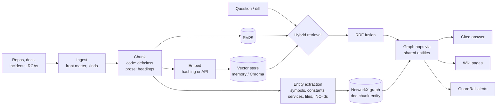

# CodeSage AI

[](https://github.com/ANIRUDH-VADERA/CodeSage-AI/actions/workflows/ci.yml)


**An engineering knowledge engine: ask questions across code, runbooks and incident history, generate cited wiki pages, and get warned when a pull request looks like a past outage.**

> CodeSage AI started as a project I built at a company AI hackathon, where it was a finalist. That build indexed **53,000 documents** (561 repositories, 1,386 incidents, 43 RCAs) and modelled knowledge bases for **1,287 users**. **This repository is an independent open-source reimplementation written from scratch.** It contains none of the original code or data and ships a small synthetic demo corpus instead.

> **Design inspiration:** Andrej Karpathy's idea of an LLM-maintained wiki, where a model keeps a living, cross-linked knowledge base up to date instead of answering from raw chunks every time. CodeSage applies it to engineering knowledge: the entity graph decides what links to what, and every generated page cites its sources.

## What it does

| Capability | How |
|---|---|
| **Ask the codebase** | Hybrid retrieval: BM25 and vector search fused with Reciprocal Rank Fusion, then expanded through an entity graph. Every answer cites `file:line`. |
| **Entity knowledge graph** | A NetworkX graph linking documents, chunks and typed entities: code symbols, config constants, services, files, incident IDs and technologies. |
| **Wiki generation** | One Markdown page per highly connected entity, with an overview, the code that uses it, related incidents and linked neighbours. Every line is cited. |
| **GuardRail for PRs** | Parses a unified diff, applies risky-change rules (removed error handling, changed timeouts, pool or retry settings, destructive SQL, dependency bumps), and finds past incidents that share symbols or files with the change. In CI it exits non-zero on high severity. |
| **Bring your own model** | Offline by default: a deterministic hashing embedder and an extractive answerer. Set `CODESAGE_API_KEY` (plus optional `CODESAGE_BASE_URL` and `CODESAGE_MODEL`) to generate answers with any OpenAI-compatible chat endpoint. From Python you can also plug in `OpenAICompatibleEmbedder` and, with `pip install "codesage[chroma]"`, a persistent `ChromaVectorStore`. |

## Architecture



### Why hybrid retrieval plus a graph?

- **BM25** finds exact identifiers such as `HTTP_TIMEOUT` and `INC-1001`, which embeddings blur.
- **Vectors** find paraphrases, for example "payments time out" matching "gateway timeouts".
- **RRF fusion** needs no score calibration between the two.
- **Graph hops** pull in chunks that share a specific entity with the best results. That is how a question about code reaches the incident that once broke it.

## Quick start

```bash
git clone https://github.com/ANIRUDH-VADERA/CodeSage-AI.git && cd CodeSage-AI
pip install -e .
codesage demo
```

Demo output on the bundled corpus (2 services, 3 incident/RCA docs, 1 runbook), abridged:

```
Indexed 8 documents -> 26 chunks, 56 graph nodes, 98 edges
Top entities: payments, timeout, ledger, INC-1001, RCA-1003, HTTP_TIMEOUT, INC-1002, BATCH_SIZE

Q: when should the ledger writer commit kafka offsets?
Writes a batch, then commits Kafka offsets. Committing first would lose messages on a crash (INC-1002). class LedgerWriter: [1]
LedgerWriter committed Kafka offsets before the Postgres write finished. When a pod was killed [2]
Commit offsets only after the batch is written, and make the write idempotent with [3]
  [1] services/ledger/writer.py:5  (via lexical, vector)
  [2] incidents/INC-1002.md:3  (via lexical, vector)
  [3] incidents/INC-1002.md:7  (via lexical, vector)

--- GuardRail review of risky.diff ---
  HIGH   error-handling-removed services/payments/client.py: Error handling was removed
         except GatewayTimeout:
  HIGH   similar-incident       services/payments/settings.py: Resembles RCA-1003 Connection pool exhaustion in payments
         shared: DB_POOL_SIZE, services/payments/settings.py
  HIGH   similar-incident       services/payments/settings.py: Resembles INC-1001 Payment timeouts after HTTP timeout was lowered
         shared: HTTP_TIMEOUT, services/payments/settings.py
  MEDIUM config-change          services/payments/settings.py: `HTTP_TIMEOUT` changed 2.0 -> 0.5
  MEDIUM config-change          services/payments/settings.py: `DB_POOL_SIZE` changed 20 -> 5
```

The risky diff lowers a timeout below the gateway's p99 latency, shrinks a connection pool, and removes a retry loop. CodeSage connects each of those to the incident it once caused.

## Use it on your own repos

```bash
codesage index ~/code --out .codesage           # repos + docs; incidents use front matter `type: incident`
codesage ask "how do we retry gateway calls?"
codesage wiki --out wiki/ --top 25
git diff main | tee /tmp/pr.diff && codesage guardrail /tmp/pr.diff   # exit 1 on high severity
```

Incident and RCA documents are Markdown with a little front matter:

```markdown
---
type: incident          # incident | rca | runbook | doc
title: INC-1001 Payment timeouts after HTTP timeout was lowered
---
```

## Project layout

```
src/codesage/
  ingest.py      corpus loading, front matter, code- and heading-aware chunking
  entities.py    typed entity extraction (symbols, constants, services, files, incidents, tech)
  vectors.py     hashing / OpenAI-compatible embedders, in-memory and ChromaDB stores
  bm25.py        Okapi BM25 with identifier-aware tokenisation
  index.py       chunks + vectors + NetworkX graph, save/load
  retrieve.py    hybrid retrieval, RRF, graph expansion
  answer.py      cited answers and wiki generation
  guardrail.py   diff parsing, risky-change rules, incident similarity
  llm.py         extractive (offline) and OpenAI-compatible answerers
tests/           12 tests over the bundled corpus
```

## Tests

```bash
python -m pytest
```

## License

MIT
